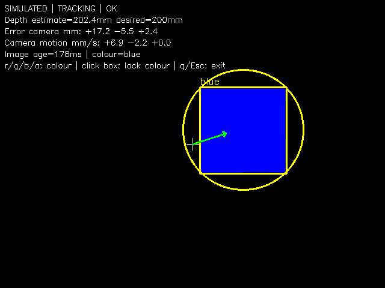

# 软件验收记录

日期：2026-11-20；本机 ROS 2 Humble、系统 Python、项目 URDF 和已有手眼/相机标定。全部使用合成图像、数值模型或假 SDK；本轮没有连接串口执行运动，也没有测量真机闭环性能。

## 已验证的链路

- 44 项单元/回归：外接圆物理直径、PID抗饱和/实际dt、相机Jacobian有限差分、近奇异DLS、严格零空间、相交边界投影、胶囊距离、限位及桌面拒绝、预览零SDK写入、执行启用后新目标、反馈失败、停止调用异常锁定、心跳丢失锁定、FK只读采样、远距离重捕获，以及原有桥接兼容测试。
- 两个后端各一项真实 ROS launch 集成：从不同工作目录启动主文件，合成相机与模拟关节闭环；持续收到有效非零六轴规划、处理图像和健康状态。Servo测试还发布合成桌面并从Servo场景服务回读确认。SIGINT后无Python异常或子进程崩溃。
- 本地 GUI：实际打开处理画面，收到连续图像；通过窗口管理器关闭窗口，确认整个规划launch关闭。解决本机GTK2不支持OpenCV可见性属性导致的误退出。
- 源码构建与作用域内静态检查通过；旧LQR数学函数只用于原有回归，运行链路已使用PID。

模拟窗口截图：

## 离线闭环轨迹

每项20秒、400周期，步长50ms；目标是世界坐标中的已知尺寸方块，使用FK相机投影得到像素及外接圆，形成反馈。均包含短时遮挡、长时遮挡、重新捕获。正常步检查速度、加速度、最终角及中间采样姿态；无可行运动时允许保持。

| 轨迹 | 最小额外限位余量 | 最大关节速度 | 最大单步角变化 | 曲线 |
| --- | --- | --- | --- | --- |
| 正弦 | 10.225° | 3.317°/s | 0.166° | [六联图](sine/tracking.png) / [3D轨迹](sine/trajectory_3d.png) |
| 阶跃 | 10.161° | 2.891°/s | 0.145° | [六联图](step/tracking.png) / [3D轨迹](step/trajectory_3d.png) |
| 边界方向大偏移 | 3.235° | 3.872°/s | 0.193° | [六联图](boundary/tracking.png) / [3D轨迹](boundary/trajectory_3d.png) |
| 近奇异、6D DLS | 27.659° | 2.797°/s | 0.140° | [六联图](singular/tracking.png) / [3D轨迹](singular/trajectory_3d.png) |

余量已在URDF限位向内扣除5°后计算。各项状态均为TRACKING 374周期、LOST 16周期、HOLD 10周期；重新捕获后继续运行。近奇异6D测试的最小归一化加权σ为 `5.31e-7`，结果有限，87步经过安全投影。其余三项为三维位置任务，σ的量纲/定义不同，不能直接与6D数值比较。边界方向轨迹用于施压，不表示已覆盖每一种边界接触；实际滑墙由独立的约束投影测试验证。

各子目录 `summary.json` 保存摘要。完整CSV/NPZ由仿真脚本生成，不将临时运行目录当成安装资源。重现命令见[使用说明](../README.md)。这些有限轨迹验证模型内行为，不能证明所有构型、真实碰撞包络或实物舵机响应都安全。
